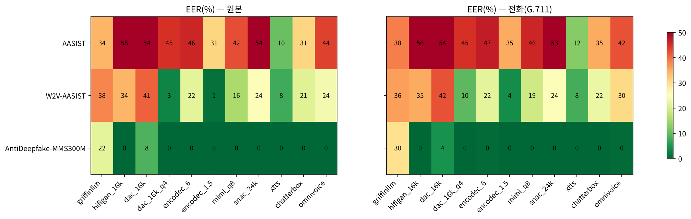

# 한국어 딥보이스 탐지 시스템 (deepvoice-detection)

한국공학대학교 컴퓨터공학부 종합설계 (2026-2 종합설계기획 → 2027 종합설계1·2)

## 개요

- 목표: 한국어 음성과 통화 환경에 강건한 딥보이스(AI 합성 음성) 탐지 모델 및 서버 기반 탐지 시스템 개발
- 접근
  - 깃허브 공개 탐지 모델을 한국어 데이터로 비교·검증하여 사용 모델 선정
  - 실제 통화 조건에서의 한계와 사각지대를 찾아 미세조정으로 보완
  - 선정 모델을 탐지 서버(API)와 클라이언트로 구현
- 팀: 이태규(팀장), 김보석, 이민영

## 진행 현황

- [x] 공개 탐지 모델 10종 조사 → 비교 대상 3종 선정 (`docs/`)
- [x] 실행 환경 구축: fairseq 없이 3종 통합 실행, 원저자 예제로 정상 동작 검증
- [x] 한국어 평가 데이터 구축 및 1차 비교 (진짜 200개 + 가짜 11종)
- [ ] 실제 통화 조건 강건성 검증 (AMR, Opus, 잡음, 대화체, 재녹음)
- [ ] 사각지대(고음질 코덱) 보완 미세조정
- [ ] 탐지 서버·클라이언트 구현

## 1차 비교 결과 (한국어)

| 탐지기 | EER 원본 | EER 전화(G.711) | 진짜→가짜 오판 (기본 기준) | 처리 시간 (RTX 2070) |
|---|---|---|---|---|
| AASIST | 40.6% | 42.4% | 28.5% | 0.02초 |
| W2V-AASIST | 23.5% | 24.6% | 59.5% | 0.06초 |
| **AntiDeepfake MMS-300M** | **6.4%** | **6.1%** | **0.0%** | 0.10초 |

- 진짜 음성: Zeroth-Korean 평가 세트 200개 (화자 10명, CC BY 4.0)
- 가짜 음성: 같은 화자·같은 문장으로 11종 생성 (보코더 2, 신경망 코덱 6, 음성 복제 TTS 3)
- AntiDeepfake 선정. 사각지대: 고음질 코덱(DAC 16kHz) 가짜의 76.5%를 진짜로 통과시킴
- 상세: `results/ko/compare.md`, `docs/한국어_딥보이스_탐지모델_비교결과.docx`

## 폴더 구조

| 경로 | 내용 |
|---|---|
| `docs/` | 조사·분석 문서, 계획서, 발표자료 |
| `vfp/detectors/` | 탐지기 3종 공통 인터페이스, fairseq 가중치 변환기 |
| `00~05_*.py` | 데이터 준비 → 가짜 음성 생성 → 채점 → 분석·비교 |
| `results/` | 채점 결과와 비교표 |
| `tests/` | 가중치 변환 교차검증 |
| `*.bat` | Windows 원클릭 실행 (환경 구축, 한국어 데이터 구축·채점) |

## 실험 재현

- 사용법: `EXPERIMENTS.md`
- 순서: `setup_and_check.bat` → `build_ko_data.bat`
- 저장소에 없는 것 (용량·권리 문제로 제외, 스크립트가 다시 받거나 만듦)
  - 모델 가중치 (`weights/`)
  - 음성 데이터 (`data/`), 특히 생성한 가짜 음성은 데이터 화자 목소리의 복제본이므로 외부 공유 금지

## 라이선스 참고

- AntiDeepfake 가중치: CC BY-NC-SA 4.0 (비상업) → 졸업작품 용도로 사용
- XTTS v2 가중치: Coqui Public Model License (비상업)
- `vfp/detectors/vendor/`: SSL_Anti-spoofing 후단 코드 (MIT, 파일 상단에 원문 고지)
