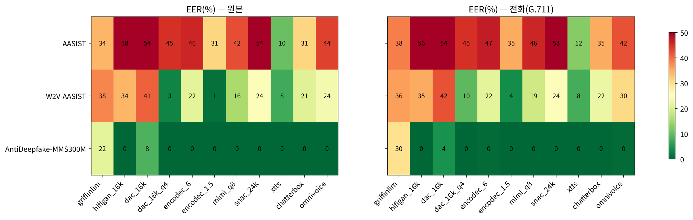

# 탐지기 비교 (한국어 평가 데이터)

- 점수: `llr` / 진짜 음성 200개(채널별)
- 생성 시스템 11종: griffinlim(고전 보코더), hifigan_16k(신경망 보코더), dac_16k(코덱), dac_16k_q4(코덱), encodec_6(코덱), encodec_1.5(코덱), mimi_q8(코덱), snac_24k(코덱), xtts(TTS 2023), chatterbox(TTS 2025), omnivoice(TTS 2026)

## A. 종합 (전체 가짜 vs 진짜)

| 탐지기 | EER 원본 | EER 전화 | 오탐률@0.5 원본 | 오탐률@0.5 전화 | 미탐률@0.5 원본 | 미탐률@0.5 전화 | 처리시간(초/파일) |
|---|---|---|---|---|---|---|---|
| AASIST | 40.6 | 42.4 | 28.5 | 47.5 | 52.8 | 37.5 | 0.023 |
| W2V-AASIST | 23.5 | 24.6 | 59.5 | 72.5 | 7.1 | 3.6 | 0.061 |
| AntiDeepfake-MMS300M | 6.4 | 6.1 | 0.0 | 0.0 | 16.2 | 11.2 | 0.095 |

단위 %. EER은 낮을수록 좋음, 오탐률은 진짜를 가짜로 오판한 비율, 미탐률은 가짜를 통과시킨 비율

## B. 생성 시스템별 EER — 원본

| detector             |   griffinlim |   hifigan_16k |   dac_16k |   dac_16k_q4 |   encodec_6 |   encodec_1.5 |   mimi_q8 |   snac_24k |   xtts |   chatterbox |   omnivoice |
|:---------------------|-------------:|--------------:|----------:|-------------:|------------:|--------------:|----------:|-----------:|-------:|-------------:|------------:|
| AASIST               |         34   |          57.5 |      54.5 |           45 |        46   |            31 |      42.5 |       53.5 |   10.5 |           31 |        43.5 |
| W2V-AASIST           |         38   |          34   |      41   |            3 |        21.5 |             1 |      15.5 |       24.5 |    7.5 |           21 |        23.5 |
| AntiDeepfake-MMS300M |         21.5 |           0   |       8.5 |            0 |         0   |             0 |       0   |        0   |    0   |            0 |         0   |

## B. 생성 시스템별 EER — 전화(G.711)

| detector             |   griffinlim |   hifigan_16k |   dac_16k |   dac_16k_q4 |   encodec_6 |   encodec_1.5 |   mimi_q8 |   snac_24k |   xtts |   chatterbox |   omnivoice |
|:---------------------|-------------:|--------------:|----------:|-------------:|------------:|--------------:|----------:|-----------:|-------:|-------------:|------------:|
| AASIST               |         38.5 |            56 |      54   |         45   |        47   |            35 |        46 |       53   |   12.5 |         35   |        42   |
| W2V-AASIST           |         36   |            35 |      42   |          9.5 |        21.5 |             4 |        19 |       24.5 |    8   |         22.5 |        30.5 |
| AntiDeepfake-MMS300M |         29.5 |             0 |       4.5 |          0   |         0.5 |             0 |         0 |        0   |    0   |          0   |         0.5 |

## C. 생성 시스템별 미탐률@0.5 — 원본

| detector             |   griffinlim |   hifigan_16k |   dac_16k |   dac_16k_q4 |   encodec_6 |   encodec_1.5 |   mimi_q8 |   snac_24k |   xtts |   chatterbox |   omnivoice |
|:---------------------|-------------:|--------------:|----------:|-------------:|------------:|--------------:|----------:|-----------:|-------:|-------------:|------------:|
| AASIST               |         48   |          79   |      76   |         58.5 |        67.5 |            33 |      50.5 |       72   |      0 |         36   |        60.5 |
| W2V-AASIST           |         22.5 |          12.5 |      25.5 |          0   |         3   |             0 |       0.5 |        3.5 |      0 |          4.5 |         6.5 |
| AntiDeepfake-MMS300M |         98   |           0   |      76.5 |          0   |         1   |             0 |       0   |        0   |      0 |          1   |         1.5 |

